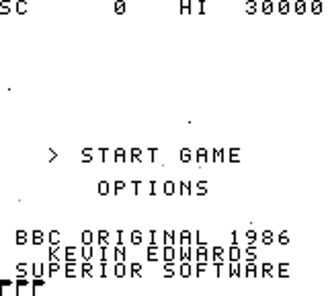
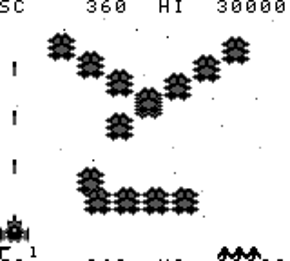
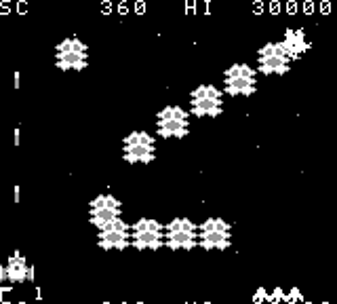
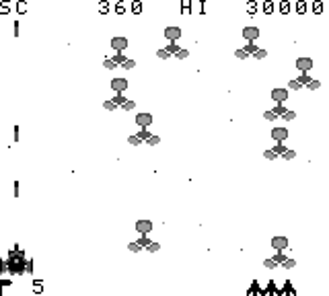
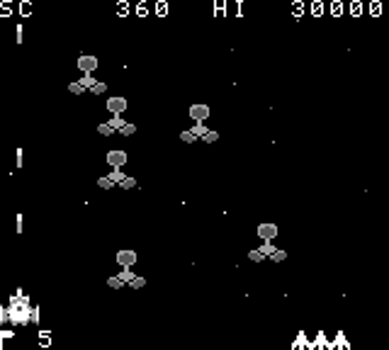
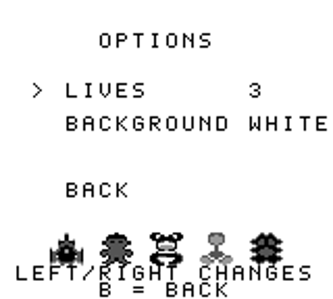
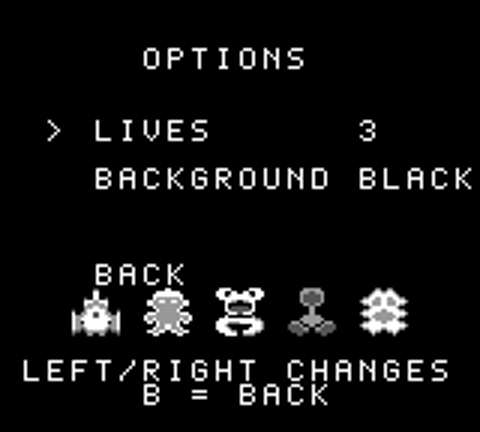

# Galaforce for Game Boy (DMG)

A Game Boy (DMG) remake of Kevin Edwards' BBC Micro shoot-'em-up *Galaforce* (1986). It keeps the original formations, flight paths and wave data, redraws the sprites for the Game Boy's small 4-shade screen, and recreates the original music and sound effects. Written in SM83 assembly (RGBDS) with Python tooling. Original source: https://github.com/KevEdwards/Galaforce1BBC (cloned to `ref/`). Personal project, not for distribution.

| White background (default) | Black background |
|---|---|
|  |  |
|  |  |
|  |  |
|  |  |

## Build
`make` (needs RGBDS and a Python venv in `.venv` with pillow, numpy, pyboy) -> `galaforce.gb` plus a versioned copy `galaforce-0.0.9.gb` (set `VERSION` in the Makefile; MBC1+RAM+battery, 32 KB ROM).
`make god` builds `galaforce_god.gb` (cannot die; used for soak tests and gameplay screenshots).

## Controls
D-pad move, A fire, Start pause, A+B+Select+Start soft reset. Title and options: Up/Down select, A or Start choose, Left/Right change a value, B go back.

## Features
- Title styled after the BBC original (SC/HI line, wide logo, small "BBC original 1986 / Kevin Edwards / Superior Software" credit, flags, occasional shine sweep, and the same scrolling starfield as in-game. Idles into a self-playing demo after about 13 s; any Start returns.
- Options: starting lives 1-5, continues 0-3 (default 1; game over asks CONTINUE? YES/NO and replays the wave with full lives) and a black or white background (white is the default); all saved in battery RAM.
- Cheat: on the options screen press Up, Up, Down, Down, Select to unlock a WAVE row (1-16, not saved).
- Screen fades, pause dimming, hi-score saved to SRAM.

## Tools and docs
`tools/`: `bot.py`, `audit.py`, `savetest.py`, `demotest.py`, `optionstest.py`, `cheattest.py`, `continuetest.py`, `makegif.py` (records `docs/screenshots/demo.gif`), `sfxlevels.py`, `audiotest.py`, `snap.py`, `screenshots.py` (regenerates `docs/screenshots/`; run `make` and `make god` first).
See `00-OVERVIEW.md`, `docs/DECISIONS.md` and `docs/PROGRESS.md` and `docs/FIXES.md` (playtest fixes). Stage plans `STAGE-01` to `STAGE-12` are all done.
