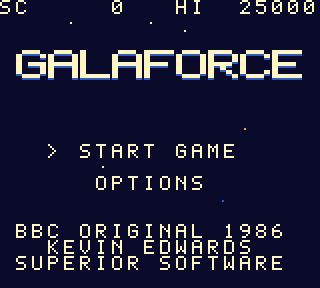
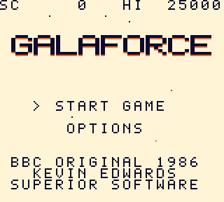
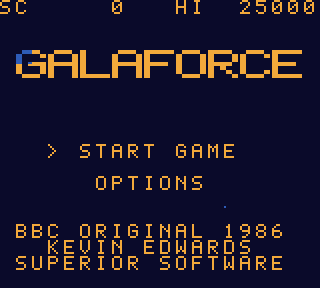
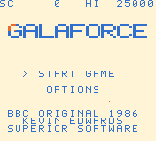

# Galaforce for Game Boy (DMG)

A Game Boy (DMG) remake of Kevin Edwards' BBC Micro shoot-'em-up *Galaforce* (1986). It keeps the original formations, flight paths and wave data, redraws the sprites for the Game Boy's small 4-shade screen, and recreates the original music and sound effects. Original source: https://github.com/KevEdwards/Galaforce1BBC. Personal project, not for distribution.

Colour recordings of the title screen and the attract-mode demo, 10 seconds each.

| | Dark background (default) | White background |
|---|---|---|
| Title screen (intro) |  |  |
| Attract-mode demo |  |  |

The original 4-shade greyscale recordings, as the hardware shows them, are `docs/screenshots/demo.gif` (white) and `docs/screenshots/demo_dark.gif` (dark).

## Build
### Setup: reference source (`ref/`)
`ref/` holds the original BBC source and data (`ref/src/PATT.asm`, `PATDAT.asm`, `WAVE.asm`, `ROUT1.asm`, ...). The build reads it, so it must be present. It is a separate git repo and is not tracked by this one (`.gitignore` lists `ref/`). From the project root:

```
git clone https://github.com/KevEdwards/Galaforce1BBC ref
```

`make` (needs RGBDS and a Python venv in `.venv` with pillow, numpy, pyboy) -> `galaforce.gb` plus a versioned copy `galaforce-1.0.0.gb` (set `VERSION` in the Makefile; MBC1+RAM+battery, 32 KB ROM).
`make god` builds `galaforce_god.gb` (cannot die; used for soak tests and gameplay screenshots).

## Controls
- In play: D-pad move, A fire.
- Smart bomb: SELECT, or A and B pressed together (a fresh press is needed, so holding both does not repeat the bomb).
- Start: pause (the screen dims). Start again to resume.
- A+B+Select+Start: soft reset to the title screen.
- Title and options: Up/Down select, A or Start choose, Left/Right change a value, B go back.

## Features

### Gameplay
- **Original waves.** The game keeps the original BBC formations, flight paths and wave data. There are 16 zones. Each wave is announced with `ENTERING` / `ZONE nn`.
- **Scoring.** The four standard alien types score 10 points each. The boss scores 80.
- **Boss zones.** ZONE 04, 08, 12 and 16 end with a boss. The first boss takes 20 hits and the later bosses take 25. Destroying one gives a bigger explosion and a smart bomb.
- **Wave multipliers.** When a pattern ends, the points you scored for it are multiplied. Killing more than 80% of the aliens gives x2. Killing every alien gives x5. The boss pattern counts too, and an `X2` / `X5` flash shows beside the score when a multiplier is paid. Aliens spawned by splitting count toward the total.
- **Smart bombs.** A smart bomb hits every alien on screen once, and the boss once. Aliens that take two hits survive with one hit left. You start each game with one bomb and can hold up to two. Bombs are kept when you lose a life. A boss kill adds one.
- **Enemy fire.** Aliens drop bombs at random. If you stay still for about 4 seconds, a live alien in line with your ship drops an aimed bomb.
- **Lives and extra life.** You start with the number of lives set in the options (default 5, range 1 to 7). You get one extra life (1UP) per game when your score reaches 20,000.
- **Continues.** The options allow 0 to 3 continues (default 0). At game over with a continue left, the screen asks `CONTINUE? YES / NO`. YES refills your lives, keeps your score and replays the wave. NO ends the game.
- **Hi-score.** The hi-score is saved to battery RAM. Each continue setting keeps its own hi-score. Until a real score is saved, the defaults are 25,000, 50,000, 75,000 and 100,000 for 0 to 3 continues. A hi-score is not recorded after a continue is used, or after a cheat start.
- **Music and sound.** The original BBC tunes and sound effects are recreated. There are tunes for the title and attract demo, game start, between waves, zone entry, lost life and game over, plus sound effects for shots, explosions, bombs and the 1UP.
- **Visual effects.** Palette fades between screens, a screen flash when a bomb is used or a life is lost, and a death flash.

### Title, options and attract mode
- **Title screen.** Styled after the BBC original: the SC and HI line, the wide logo, the credit line for the 1986 original (Kevin Edwards, Superior Software), the flags, an occasional shine sweep, and the same scrolling starfield as in-game.
- **Attract-mode demo.** The title screen idles into a self-playing demo after about 13 seconds. The demo ship is invulnerable and runs for about 30 seconds. Any Start press returns to the title, and the hi-score is not changed by the demo.
- **Options.** Lives (1 to 7), continues (0 to 3), and a black or white background (black is the default). The options are saved in battery RAM with a checksum.
- **Cheat: level select.** On the options screen, press Up, Up, Down, Down, Select to reveal a `ZONE` row (1 to 16). It is not saved, and a game started this way does not record a hi-score. The demo ignores it.
- **Secret screen.** On the options screen, press Down, Down, Up, Up, Select to see a flashing screen, a growing heart and the words `FOR MAYA`. A, B, Start or Select returns to the options.
